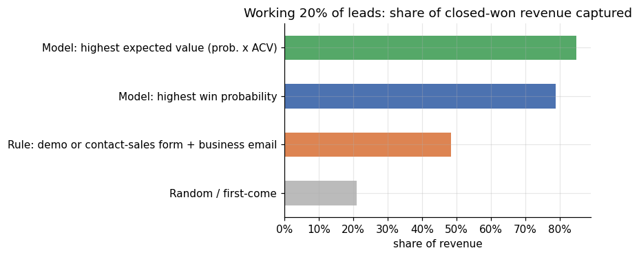
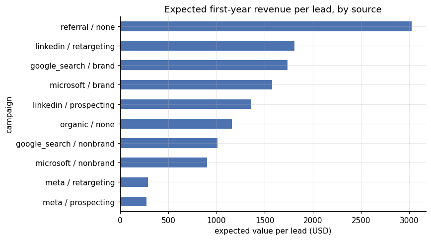
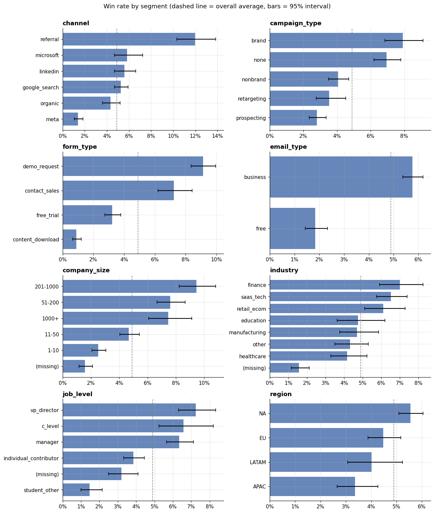
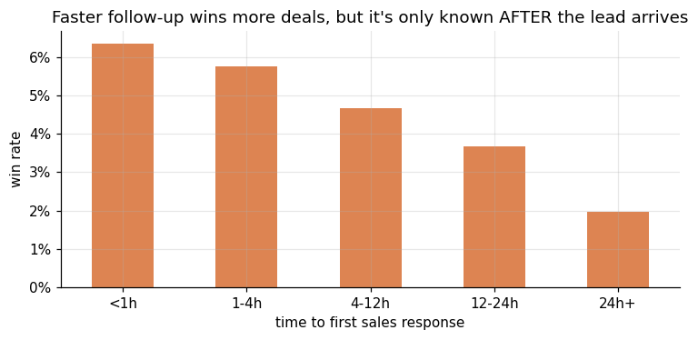

# Findings: which leads should sales call first?

**Short version:** the leads that look the most promising on paper are not the ones that bring in the most money. A simple scoring model, built only from what is known the moment someone fills in a form, let sales focus on 1 lead in 5 and still reach **79% of all closed revenue**. The rule most teams use today reached 49%.

## The problem

A B2B software company gets thousands of inbound leads: demo requests, free-trial sign-ups, "contact sales" forms and content downloads. Fewer than 1 in 20 become paying customers within 90 days.

Sales can't give every lead fast, careful attention. Most teams either work leads in the order they arrive or use a simple rule such as "demo requests from business email addresses go first." The question this project answers is:

**If sales can only give their best effort to 20% of leads, which 20% should they be?**

## What I did

1. I created a realistic dataset of 20,000 leads over 18 months, from Google, Meta, LinkedIn, Microsoft Ads, organic search and referrals. Because I built it, I know each lead's true chance of closing, so I can check how well the model does.
2. I looked at which kinds of leads close most often, and checked for traps that make results look better than they really are, such as using information that only exists after a deal is already moving.
3. I trained a model on 16,000 older leads whose outcomes are known, and tested it on leads it had never seen.
4. I gave each new lead a score, sorted them into A, B and C tiers, and compared the results against working leads in arrival order and against the common rule.
5. For each lead, I listed the top three reasons behind its score in plain words, so a sales rep can see why it's a priority.

---

## Finding 1: a scoring model reaches far more revenue than a simple rule

In a test group of 4,018 leads, I gave each approach the same capacity: 803 leads, or 20% of the group.

| Approach | Share of deals won | Share of revenue won | Revenue won |
|---|---|---|---|
| Work leads in arrival order | 21% | 21% | $1.18M |
| Rule: demo or contact-sales form + business email | 44% | 49% | $2.73M |
| Model: highest chance of closing | 68% | 79% | $4.43M |
| Model: highest expected deal value | 57% | 85% | $4.77M |

The common rule is twice as good as working leads in arrival order. But the model reaches an extra **$1.7M of revenue for the same sales effort** in this test group alone.

The last two rows show a real business choice. Ranking leads by **chance of closing** wins the most deals. Ranking by **expected deal value** (chance of closing × typical deal size) wins fewer deals but more revenue, because it puts larger companies first. A team paid on number of deals and a team paid on revenue should rank leads differently.

## Finding 2: cheap leads are not the same as good leads

Each lead is worth its chance of closing multiplied by its likely deal size. On that measure, sources differ by about 10 times:

| Source | Expected revenue per lead | Share of leads that are A-tier | Actual win rate |
|---|---|---|---|
| Referral | $3,022 | 59% | 12.6% |
| LinkedIn retargeting | $1,808 | 23% | 5.1% |
| Google Search, brand terms | $1,734 | 37% | 8.4% |
| Microsoft Ads, brand terms | $1,575 | 36% | 8.7% |
| LinkedIn prospecting | $1,359 | 18% | 6.3% |
| Organic | $1,162 | 19% | 3.1% |
| Google Search, non-brand | $1,003 | 16% | 4.0% |
| Microsoft Ads, non-brand | $908 | 14% | 6.3% |
| Meta retargeting | $285 | 5% | 0.7% |
| Meta prospecting | $273 | 3% | 1.4% |

Meta brings in a lot of leads, often at a low cost per lead, but each one is worth about a tenth of a referral and about a quarter of a non-brand Google lead. For Meta to be a good investment, its leads would need to cost about a quarter of a Google non-brand lead.

Marketing reports usually stop at cost per lead. Adding **expected revenue per lead** shows which channels deliver customers, not just form fills.

## Finding 3: what a good lead looks like

The strongest signals, in plain terms:

| Signal | Closes more often | Closes less often |
|---|---|---|
| What the lead asked for | Demo request: 9.1% | Content download: 0.9% |
| Email address | Business email: 5.8% | Free email (Gmail etc.): 1.8% |
| Company size | 201–1,000 employees: 9.5% | 1–10 employees: 2.5% |
| Job level | VP / Director: 7.3% | Student / other: 1.5% |
| Company details on file | Known: 5.6% | Missing: 1.6% |

Two things are less obvious:

- **A pricing-page visit matters most for larger companies.** It roughly doubles the win rate for very small companies, but multiplies it by about 3.5 for companies with 201–1,000 employees (from 5.0% to 17.7%). A large company checking the price is usually a serious buyer.
- **Missing information is itself a warning sign.** When the company's size and industry can't be found, the lead usually used a personal email address, and those leads close at about a third of the normal rate.

No single signal is enough on its own. A demo request from a 5-person company using a Gmail address is a weaker lead than a "contact sales" form from a VP at a 500-person company who looked at pricing. The model weighs all of these signals together.

## Finding 4: fast follow-up matters, but it's a lever, not a signal

| Time until sales first responded | Win rate |
|---|---|
| Under 1 hour | 6.4% |
| 1–4 hours | 5.7% |
| 4–12 hours | 4.7% |
| 12–24 hours | 3.7% |
| Over 24 hours | 2.0% |

Leads that hear back within an hour close about three times as often as leads left waiting over a day.

I deliberately **did not** use response time in the score. It only exists after a lead has arrived, so using it would make the model look more accurate than it can be in real life. Response time isn't a property of the lead; it's something the sales team controls.

The score and response time work together: **the score tells sales which leads to answer first, and answering those quickly raises the chance of closing.**

## Finding 5: the scores can be trusted, and a simple model was almost as good

Because the data is simulated, I could check the model against how each new lead really turned out:

| Tier | Share of new leads | Predicted win rate | Actual win rate | Share of all wins |
|---|---|---|---|---|
| A | 21% | 14.8% | 14.0% | 68% |
| B | 29% | 4.2% | 3.5% | 23% |
| C | 51% | 1.0% | 0.7% | 8% |

When the model says a lead has a 15% chance, about 15% of those leads close, so sales and finance can use the scores for planning, not just ranking. The model ran slightly optimistic overall, predicting 187 wins against 167 actual, so forecasts built on it should be trimmed a little.

I also compared a simple, transparent model with a more complex one. The complex model was only slightly better. For a sales team that needs to trust and understand the score, the simpler model would be a reasonable choice.

---

## Recommendations

1. **Answer A-tier leads within the hour, with a senior rep.** A-tier leads are 1 in 5 of all leads but bring in about two-thirds of wins. They are where fast follow-up pays off most.
2. **Decide whether you're ranking for deals or for revenue.** Rank by chance of closing if the goal is more customers. Rank by expected deal value if the goal is revenue, which puts larger companies first.
3. **Don't drop B and C leads; route them differently.** B-tier leads still bring about a quarter of wins and suit standard follow-up. C-tier leads can go to automated email nurture rather than a rep's calendar.
4. **Report expected revenue per lead next to cost per lead, by channel.** Without it, high-volume, low-quality sources like Meta look better than they are.
5. **Fill in missing company details.** Use an enrichment tool, or ask for company size on high-intent forms. Missing data hides good leads and makes weak ones look average.
6. **Test the speed-to-lead effect properly.** Randomly assign some A-tier leads to an immediate-response group to measure how much faster follow-up really adds.

## Limitations

- **Simulated data.** The patterns are realistic but built by me. Real CRM data has duplicates, inconsistent stages and changing definitions that need cleaning first. My previous project, the [Marketing Mix Model](https://github.com/paolofelix/marketing-mix-model), uses the same approach of checking a model against a known truth.
- **No advertising cost data.** Finding 2 compares value per lead, not return on spend. Combining it with cost per lead would show true return by channel.
- **Deal size is estimated** from the typical deal for each company size, not predicted per lead.
- **The speed-to-lead effect is shown, not proven.** In real data, faster replies might go to leads that already looked better. Only an experiment can separate the two.
- **The 20% cut-off is a capacity choice**, not something the model decides. A team with more reps would set a bigger A tier.

## What I'd do next with real data

- Connect the score to the CRM so every new lead is scored and tiered the moment it arrives.
- Send expected lead values back to Google Ads and Meta, so their bidding chases valuable leads rather than any form fill.
- Re-check the model every month as channels, campaigns and products change.
- Run the speed-to-lead experiment from Recommendation 6.
- Add a separate deal-size prediction to sharpen the revenue ranking.
