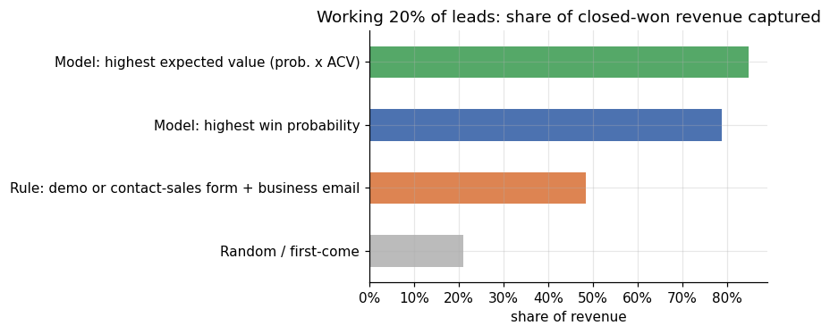
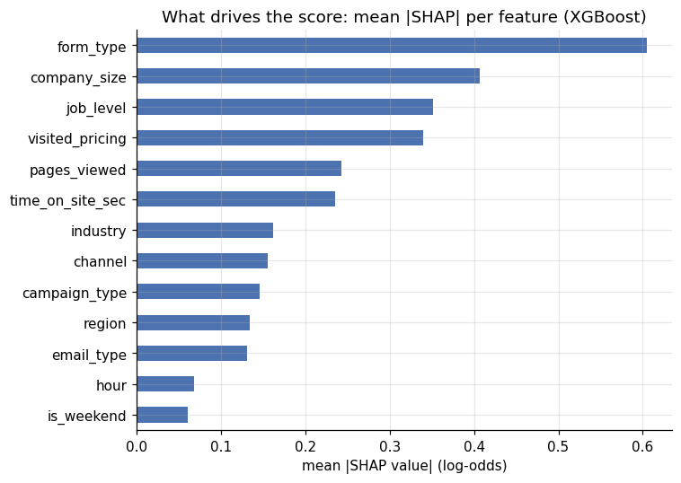
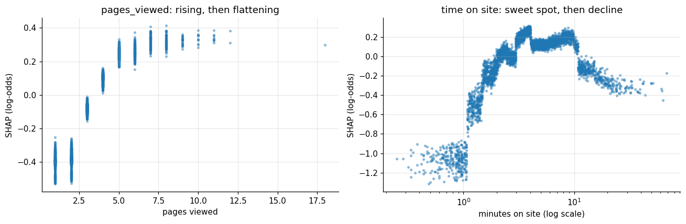
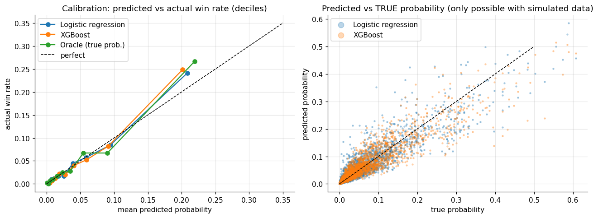

# Lead Scoring Model: Predicting Which B2B Leads Close

[](https://paolofelix-lead-scoring-model.streamlit.app/)

**▶ [Try the interactive dashboard](https://paolofelix-lead-scoring-model.streamlit.app/)**: set your sales capacity and compare how many wins and how much revenue each way of ranking leads captures, browse the scored lead queue, or score a lead yourself.

Predicts which inbound B2B SaaS leads will become closed-won deals within 90 days, using only information available the moment the form is submitted. Leads are then ranked by win probability and expected deal value, so sales works the right 20% first.

The data is simulated, so the **true** win probability of every lead is known. That lets the model be checked against ground truth, not just against noisy outcomes.

📄 **[Read the findings write-up →](FINDINGS.md)** · 📊 **[Open the live dashboard →](https://paolofelix-lead-scoring-model.streamlit.app/)**

> **Part 4 of a marketing analytics series**
>
> 1. [Multi-channel attribution & ROAS](https://github.com/paolofelix/multichannel-attribution-roas): which channel gets credit?
> 2. [Cohort LTV & CAC payback](https://github.com/paolofelix/cohort-ltv-cac-payback): what is a customer worth, and how fast does spend pay back?
> 3. [Marketing Mix Model](https://github.com/paolofelix/marketing-mix-model): what would have happened *without* each channel?
> 4. **Lead Scoring Model**: which leads will actually close, and which should sales call first?

**Stack:** Python, pandas, scikit-learn, XGBoost, SHAP, Matplotlib, Plotly, Streamlit, Google Colab

---

## Key results

| Model (held-out test set, 4,018 leads) | ROC AUC | PR AUC | Brier |
|---|---|---|---|
| Logistic regression | 0.836 | 0.261 | 0.0410 |
| XGBoost | 0.840 | 0.276 | 0.0408 |
| Oracle (true probabilities) | 0.851 | 0.298 | 0.0400 |

- **The model is close to the best possible ranking.** XGBoost reaches 0.840 AUC against a ceiling of 0.851.
- **Working the top 20% of leads captures 68% of wins and 79% of revenue**, at a 16.5% win rate vs 4.9% overall.
- **It beats the current routing rule** ("demo or contact-sales form + business email"), which captures 44% of wins and 49% of revenue with the same capacity.
- **Ranking by expected value (probability × deal size) captures 85% of revenue**, at the cost of fewer wins (57%). That's a business choice, not a modelling one.
- **XGBoost barely beats logistic regression.** With about 600 training wins and a mostly additive signal, the simpler model is nearly as good, and easier to explain to a sales team.
- **The probabilities are well calibrated without any post-processing**, because no class re-weighting or oversampling was used. A score of 0.20 really means about a 20% chance of closing.
- **Lead quality varies about 10x by source:** referral leads are worth ~$3.0k each in expected first-year revenue, Meta leads ~$0.3k. A cost-per-lead report would hide this.



---

## The problem

Inbound leads vary a lot in quality, and sales capacity is limited. Most teams route leads first-come-first-served or with a simple rule. This project asks: **if sales can only give fast, senior follow-up to 20% of leads, which 20% should they be?**

## Data

20,000 simulated leads (Jan 2025 – Jun 2026) from Google Search, Meta, LinkedIn, Microsoft Ads, organic and referral, with:

- **Source:** channel, campaign type (brand / non-brand / prospecting / retargeting), form type
- **Firmographics:** company size, industry, job level, region, business vs free email
- **On-site behaviour:** pages viewed, pricing-page visit, time on site
- **Outcomes:** SQL flag, closed-won within 90 days, close date, annual contract value (ACV)

The simulation includes realistic problems on purpose:

| Problem | How it's handled |
|---|---|
| **Enrichment gaps:** company size and industry are missing for 57% of free-email leads vs 5% of business-email leads | Missing kept as its own category, because "missing" carries signal (1.6% win rate vs 5.6%) |
| **Data leakage:** `first_response_hours` strongly predicts wins (6.4% if under 1h, 2.0% if 24h+), but is only known *after* the lead arrives. `is_sql` is a downstream funnel stage | Both excluded from the model (see `data/feature_spec.json`) |
| **Unfinished outcomes:** leads from the last 90 days haven't had time to close | Trained only on 16,071 matured leads. The 3,929 recent leads are scored as "new leads" |
| **Non-linear effects:** diminishing returns on pages viewed, a time-on-site sweet spot, a pricing-visit × company-size interaction | Captured by XGBoost and confirmed with SHAP |
| **`"NA"` = North America** gets read as missing by pandas by default | Loaded with `keep_default_na=False` |

## Approach

1. **Simulate** (`01_simulate_data.ipynb`): generate leads from a known data-generating process and save the true probabilities separately in `data/ground_truth/`. The model never reads them.
2. **EDA** (`02_eda.ipynb`): win rates by segment with 95% Wilson intervals, non-linear shapes, interactions, missing-data patterns, leakage checks.
3. **Model** (`03_model.ipynb`): logistic regression baseline vs XGBoost, 5-fold stratified cross-validation, test-set evaluation against the oracle, calibration, cumulative gains, SHAP.
4. **Scoring and impact** (`04_scoring_and_impact.ipynb`): A/B/C tiers, comparison against random and rule-based routing, expected value per lead, a lead-quality view by source, and a scored export of new leads with plain-language reason codes for sales reps.

## Findings in detail

### What drives a lead's score
Form type matters most, followed by company size, job level and pricing-page visits. Demo requests win about 10x as often as content downloads (9.1% vs 0.9%).



### The model learned the non-linear shapes
More pages viewed helps, but the effect flattens after about 7 pages. Time on site has a sweet spot (roughly 3–10 minutes) and then declines.



### Calibration


### Tiers
Cut-offs were set on the test set (A = top 20%, B = next 30%, C = bottom 50%) and applied unchanged to new leads:

| Tier | Share of leads | Win rate | Share of wins | Share of revenue |
|---|---|---|---|---|
| A | 20% | 16.5% | 68% | 79% |
| B | 30% | 3.7% | 23% | 16% |
| C | 50% | 0.9% | 10% | 5% |

On the 3,929 new leads, checked against the ground truth, tier A's true win rate is 14.0% (predicted 14.8%), and tier A captures 68% of eventual wins. Total wins are slightly over-predicted (187 vs 167 actual).

### Example output for sales
`outputs/scored_new_leads.csv` lists every new lead with its score, tier, expected value and top three reasons, for example:

> `L103204` · referral · contact_sales · 201–1000 employees · score 0.56 · Tier A · reasons: company_size=201-1000; channel=referral; visited_pricing=1

## Interactive dashboard

**Live app:** https://paolofelix-lead-scoring-model.streamlit.app/

`dashboard/app.py` is a Streamlit app built on the scored new leads (`outputs/scored_new_leads.csv`) and the simulation's ground truth, so every result is checked against how each lead really turned out:

| Tab | What you can do |
|---|---|
| **Prioritisation** | Set how many leads sales can work first (5–60%) and compare the share of wins and revenue captured by the model, expected-value ranking, the current routing rule and arrival order, with cumulative gains curves |
| **Lead quality by source** | Compare expected revenue per lead, share of A-tier leads and actual win rate by channel and campaign type, and work out the most each source can pay per lead for a target return |
| **What drives a win** | See win rates by any segment with 95% Wilson intervals, how a pricing-page visit matters more at larger companies, and the speed-to-lead effect |
| **Lead queue** | Filter scored new leads by tier, channel and form type, rank them by score or expected value, read the plain-language reasons, and download the list as CSV |
| **Score a lead** | Enter a lead's details to get its win probability, tier, expected value, a suggested action, and a chart of what pushed the score up or down |
| **Model performance** | Compare test-set metrics with the oracle, check predicted vs actual win rate by tier, and view the calibration, gains and SHAP charts |

**Note:** the "Score a lead" tab uses a logistic regression that the app retrains when it starts (held-out ROC AUC ≈ 0.84, in line with the logistic baseline above). The saved `.joblib` pipelines only load with the exact library versions used in Colab. Scores and tiers everywhere else come from the XGBoost model in the notebooks.

To run it locally (from the repo root):

    pip install -r dashboard/requirements.txt
    streamlit run dashboard/app.py

## Limitations

- **Simulated data.** Real CRM data is messier, with duplicate leads, changing field definitions and inconsistent stage updates.
- **Random train/test split.** A time-based split would better reflect deployment and detect drift.
- **Expected value uses median ACV by company size.** A separate deal-size model would be more precise.
- **Prioritisation only.** The model ranks leads but doesn't estimate how much faster follow-up *causes* more wins. That would need an experiment.
- **Tier cut-offs are a capacity decision** (top 20%), not a model output.

## How to run

1. Open the notebooks in Google Colab, in order 01 → 04.
2. The first cell of each notebook mounts Google Drive and works in `MyDrive/lead-scoring-model/`, so outputs persist between notebooks.
3. Install dependencies with `pip install -r requirements.txt` (Colab already has most of them).

## Repository structure

```
data/                  leads.csv, feature_spec.json, ground_truth/ (validation only)
notebooks/             01_simulate_data → 04_scoring_and_impact
src/simulate_data.py   data-generating process
models/                trained logistic regression + XGBoost pipelines
outputs/               model_comparison.csv, scored_new_leads.csv, figures/
dashboard/             Streamlit app (app.py) and its requirements.txt
.streamlit/            dashboard theme (config.toml)
```

## License
MIT
